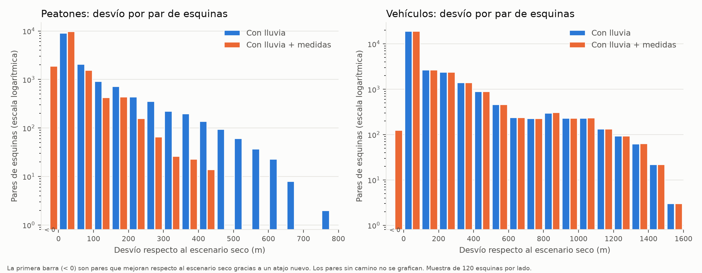

# Informe de cambios: prioridad 2 (modelo y código)

Caso de estudio: arroyo El Salao, Soledad. Todo se puede reproducir desde `proyecto_arroyos/`:

```
python main.py                              # resultados oficiales (resumen.txt, analisis.json, mapa.png)
python herramientas/diagnostico_sin_camino.py   # hipótesis de los 240 pares
python herramientas/experimentos.py         # voraz, críticos, sensibilidad, control, histograma (unos 8 min)
python -m unittest                          # 30 pruebas (22 originales + 8 nuevas)
```

La línea base anterior a los cambios está en `resultados/linea_base/`. **Los resultados oficiales no cambiaron**: `analisis.json` nuevo y la línea base son idénticos campo por campo, salvo dos campos agregados (`desvio_fijo_m` y `recuperados`).

## Resumen en cinco líneas

1. Los **240 pares sin camino** no son 240 fallas distintas: son **2 esquinas sin acceso** (cada una recibe 120 pares). Dependen de la muestra: con otra posición de la muestra salen 0, 120 o 240.
2. El orden lexicográfico (pares sin camino, luego desvío) **ya estaba** en el código. Lo que faltaba era *mostrarlo*: ahora se reporta un desvío sobre un **conjunto fijo de pares** y los pares recuperados, y la confusión de la calle de 6 m desaparece.
3. El **voraz coincide con el óptimo** (fuerza bruta, k = 2) en peatones y en vehículos, con todos los candidatos reales. Pero hay casos construidos donde no lo alcanza (arcos complementarios).
4. Para **peatones** las conclusiones son estables (primer puente, desvío entre 24 y 29 m). Para **vehículos** no: la medida recomendada **cambia según la muestra**.
5. El control del lado por componentes conexas **coincide al 100 %** con el producto cruz.

---

## 1. Hipótesis de los 240 pares

**Hipótesis:** los 240 pares sin camino son una sola esquina aislada (2 × 120). **Resultado: casi, pero son dos.**

| | Esquina B | Esquina A |
|---|---|---|
| Nodo OSM | [11759103826](https://www.openstreetmap.org/node/11759103826) | [11011198579](https://www.openstreetmap.org/node/11011198579) |
| Lado | sur | norte |
| Nombre | esquina cerca de Avenida Murillo | esquina cerca de Carrera 22D |
| Único acceso en carro | tramo 8352 (`primary_link`, 56 m, un solo sentido), **bloqueado: cruza el cauce** | tramo 5760 (`unclassified`, 16,6 m, un solo sentido), **bloqueado: cruza el cauce** |
| Salida | tramo 8353 (`primary_link`, 6,1 m, un solo sentido) | tramo 5761 (74 m) |
| Pares sin camino | 120 (ninguna esquina de la otra orilla de la muestra le llega) | 120 |

- Cada una es **destino** de los 120 pares que vienen del otro lado: 2 × 120 = **240**.
- En toda la zona (1.086 esquinas) hay una tercera, **C** ([11759002035](https://www.openstreetmap.org/node/11759002035)), a la que solo se llega pasando por A. No cayó en la muestra.
- Con todas las esquinas, en lugar de la muestra, hay **2.170 pares sin camino de 587.248 (0,37 %)**. Con la muestra oficial son 240 de 28.800 (0,83 %).
- Con las medidas, quedan 508 pares sin camino con todas las esquinas.

**Qué cambia en la explicación del resultado vehicular:**

- La cifra «240 pares sin camino» no mide cuánta gente queda aislada. Mide **cuántas esquinas de la muestra** son callejones de un solo sentido cuyo único acceso cruza el arroyo.
- La «calle de 6 m» es el tramo 8353: una `primary_link` de un solo sentido (una rampa) junto a la avenida Murillo. La medida propone **invertirla** para poder entrar a B. Los 120 pares que recupera tienen desvío **negativo**: llegan por un camino nuevo que no existe en seco. **No restituye nada que la lluvia haya quitado.** Es muy probable que no sea una medida realista; hay que verla en Street View (pendiente de Persona 2).

Se reproduce con `python herramientas/diagnostico_sin_camino.py`.

## 2a. Función objetivo

**Antes:** el código ya ordenaba los candidatos de forma lexicográfica, `(pares sin camino, desvío medio)`, en `Metricas.objetivo` y en `Evaluador.objetivo`. La **elección de medidas no cambia**: ni en vehículos ni en peatones.

**El problema real era de reporte.** El desvío medio se calcula solo sobre los pares con camino, así que cuando una medida devuelve el camino a un par, ese par entra al promedio con un recorrido largo y la media sube (137,5 → 137,6 m con la calle de 6 m), aunque la medida no empeora nada.

**Qué se agregó** (`src/analisis.py`, sin cambiar lo anterior):

- `desvio_fijo_m`: desvío medio **solo sobre los pares que ya tenían camino con lluvia**, antes de cualquier medida. Es un conjunto fijo, así que **nunca sube** al agregar una medida.
- `recuperados`: pares que pasan de «sin camino» a «con camino».
- `main.py` los imprime en `resumen.txt` y `analisis.json` los guarda por escenario y por medida.

**Antes / después (vehículos, muestra oficial):**

| Escenario | Pares sin camino | Desvío medio (antes, sobre pares con camino) | Desvío fijo (nuevo) | Pares recuperados |
|---|---|---|---|---|
| Lluvia | 240 | 137,5 m | 137,5 m | – |
| + calle de 6 m | 120 | 137,6 m | **137,5 m** | 120 |
| + calle de 112 m | 120 | 132,5 m | **132,3 m** | 120 |

La lectura correcta: la calle de 6 m **no cambia el desvío de ningún par que ya tenía camino** (137,5 → 137,5) y abre un camino a 120 pares. La de 112 m es la que baja el desvío (137,5 → 132,3 m, 3,8 %).

Peatones: sin pares sin camino, así que `desvio_fijo_m` = desvío medio (69,7 → 26,1 m con 3 puentes).

## 2c. Voraz contra fuerza bruta (k = 2)

Se probaron **todas las parejas** de candidatos reales de El Salao, no un grafo de juguete. Cada pareja se evalúa exactamente (`src/comparacion.py`), y el óptimo se verificó volviendo a calcular Dijkstra desde cero.

Objetivo = (pares sin camino, desvío medio en m). Menor es mejor.

| Medida | Candidatos | Parejas probadas | Voraz | Óptimo (fuerza bruta) | Pares sin camino de más | Desvío de más (m) | Misma pareja | Óptimo verificado desde cero |
|---|---|---|---|---|---|---|---|---|
| Puentes peatonales | 50 | 1225 | (0, 31.865) | (0, 31.865) | 0 | 0.0 | sí | sí |
| Doble sentido | 151 | 11325 | (120, 132.452) | (120, 132.452) | 0 | 0.0 | sí | sí |

**Resultado:** en los dos casos el voraz **elige la misma pareja que el óptimo**; la diferencia es 0 pares y 0 m.

**Límites, que deben ir en el documento:**

- Es una cota **empírica** para este caso y k = 2. No demuestra que el voraz sea óptimo en general.
- El voraz solo recomienda medidas que mejoran al menos 2 %; la fuerza bruta no tiene ese umbral.
- Hay casos donde el voraz **falla**, y están en una prueba: si dos arcos solo sirven juntos (a→m y m→b conectan s con t, pero ninguno mejora nada por separado), el voraz no elige ninguno y el óptimo sí (`tests/test_mejoras.py`, `test_arcos_complementarios_el_voraz_no_llega_al_optimo`).
- No se hizo k = 3: con 50 candidatos peatonales son 19.600 ternas y con 151 vehiculares, unas 560.000. Es viable para peatones; no se hizo por tiempo.

## 2b. Intermediación (cruces críticos)

Algoritmo de Brandes con pesos (ya estaba en `src/grafo.py`), sobre el **grafo vehicular completo** (5.443 esquinas), en seco y con lluvia. Tardó unos 2,5 minutos. Valores normalizados a [0, 1].

Grafo vehicular: 5443 esquinas. Valores normalizados a [0, 1] (Brandes con pesos).

**Mayor intermediación en seco**

| # | Esquina | Valor | Distancia al cauce (m) | OSM |
|---|---|---|---|---|
| 1 | Avenida Murillo x Carrera 18 | 0.17992 | 292 | 1882408906 |
| 2 | Avenida Murillo x Carrera 18 | 0.16570 | 291 | 2236701401 |
| 3 | Carrera 18 | 0.15777 | 291 | 5413354998 |
| 4 | Calle 56 x Carrera 18 | 0.15451 | 421 | 950517568 |
| 5 | Carrera 17D x Carrera 18 | 0.13893 | 416 | 950442834 |
| 6 | Calle 60 x Carrera 18 | 0.13432 | 279 | 1879842413 |
| 7 | Calle 63 x Carrera 18 | 0.12539 | 293 | 9247173693 |
| 8 | Calle 63 x Carrera 18 | 0.12505 | 291 | 9274144973 |
| 9 | Calle 69 x Carrera 15A | 0.12474 | 555 | 1882408402 |
| 10 | Carrera 18 | 0.12367 | 291 | 11759103819 |

**Mayor intermediación con lluvia**

| # | Esquina | Valor | Distancia al cauce (m) | OSM |
|---|---|---|---|---|
| 1 | Avenida Murillo x Carrera 18 | 0.20219 | 292 | 1882408906 |
| 2 | Avenida Murillo x Carrera 18 | 0.19798 | 291 | 2236701401 |
| 3 | Carrera 18 | 0.17765 | 291 | 5413354998 |
| 4 | Calle 56 x Carrera 18 | 0.16433 | 421 | 950517568 |
| 5 | Calle 60 x Carrera 18 | 0.15007 | 279 | 1879842413 |
| 6 | Calle 63 x Carrera 18 | 0.14996 | 291 | 9274144973 |
| 7 | Carrera 18 | 0.14850 | 291 | 11759103819 |
| 8 | Calle 61 x Carrera 18 | 0.14642 | 280 | 950518889 |
| 9 | Carrera 18 | 0.14631 | 292 | 1879842416 |
| 10 | Calle 62 x Carrera 18 | 0.14616 | 289 | 1879842415 |

**Mayor aumento con lluvia (toda la red)**

| # | Esquina | Valor | Distancia al cauce (m) | Seco | Lluvia | OSM |
|---|---|---|---|---|---|---|
| 1 | Calle 72 | 0.06281 | 4 | 0.03213 | 0.09493 | 1882409076 |
| 2 | Calle 72 | 0.06271 | 6 | 0.03209 | 0.09480 | 1882409081 |
| 3 | Calle 72 x Carrera 22 | 0.05602 | 69 | 0.04036 | 0.09638 | 1882409162 |
| 4 | Calle 72 x Carrera 20 | 0.05409 | 46 | 0.04384 | 0.09792 | 1882408993 |
| 5 | Calle 64 x Carrera 18 | 0.04422 | 299 | 0.07713 | 0.12135 | 1882408901 |
| 6 | Calle 66 x Carrera 18 | 0.04420 | 284 | 0.07692 | 0.12112 | 1882408896 |
| 7 | Calle 65 x Carrera 18 | 0.04227 | 289 | 0.08049 | 0.12276 | 1882408899 |
| 8 | Calle 72 x Carrera 22 | 0.04180 | 80 | 0.02788 | 0.06968 | 1882409204 |
| 9 | Calle 71 x Carrera 20 | 0.03621 | 54 | 0.02534 | 0.06155 | 1882408998 |
| 10 | Calle 70 x Carrera 20 | 0.03583 | 59 | 0.02498 | 0.06081 | 1882409004 |

**Mayor aumento con lluvia (zona de estudio)**

| # | Esquina | Valor | Distancia al cauce (m) | Seco | Lluvia | OSM |
|---|---|---|---|---|---|---|
| 1 | Calle 72 x Carrera 22 | 0.05602 | 69 | 0.04036 | 0.09638 | 1882409162 |
| 2 | Calle 72 x Carrera 20 | 0.05409 | 46 | 0.04384 | 0.09792 | 1882408993 |
| 3 | Calle 64 x Carrera 18 | 0.04422 | 299 | 0.07713 | 0.12135 | 1882408901 |
| 4 | Calle 66 x Carrera 18 | 0.04420 | 284 | 0.07692 | 0.12112 | 1882408896 |
| 5 | Calle 65 x Carrera 18 | 0.04227 | 289 | 0.08049 | 0.12276 | 1882408899 |
| 6 | Calle 72 x Carrera 22 | 0.04180 | 80 | 0.02788 | 0.06968 | 1882409204 |
| 7 | Calle 71 x Carrera 20 | 0.03621 | 54 | 0.02534 | 0.06155 | 1882408998 |
| 8 | Calle 70 x Carrera 20 | 0.03583 | 59 | 0.02498 | 0.06081 | 1882409004 |
| 9 | Calle 69 x Carrera 20 | 0.03570 | 67 | 0.02506 | 0.06077 | 1882409009 |
| 10 | Avenida Murillo x Carrera 18 | 0.03228 | 291 | 0.16570 | 0.19798 | 2236701401 |

Esquinas en común entre los 10 primeros en seco y con lluvia: 7.

**Lectura:**

- **En seco y con lluvia** los más críticos son esquinas de la **avenida Murillo con la carrera 18** y el resto de la **carrera 18**, a unos 290 m del arroyo. La red depende de ese corredor.
- **Los que más ganan con lluvia** están pegados al cauce: la **calle 72** (esquinas a 4–6 m del arroyo, junto al puente de la calle 72) y sus cruces con las carreras 20 y 22. Es donde se concentra el tráfico que antes pasaba por los cruces bloqueados.
- Siete de las diez primeras son las mismas en seco y con lluvia.

**Precauciones al citarlo:**

- La intermediación se calcula sobre toda la red del recuadro, no solo sobre los pares de la muestra, y no pondera por demanda: dice por dónde pasan más caminos mínimos, no por dónde pasa más gente.
- Hay esquinas con el mismo nombre (una avenida tiene muchos nodos); la tabla da el identificador OSM para distinguirlas.
- Los bordes del recuadro pueden alterar los valores.
- No se usó para elegir medidas; solo describe el problema.

## 2d. Sensibilidad

Se varió la luz máxima del puente peatonal y el tamaño y la posición de la muestra de esquinas (`DESFASE_MUESTRA` corre la muestra sin cambiar su tamaño).

**Luz máxima del puente peatonal** (muestra oficial de 120 por lado, 3 puentes)

| Luz (m) | Candidatos | Desvío con lluvia (m) | Desvío con 3 puentes (m) | Primer puente |
|---|---|---|---|---|
| 20 | 28 | 69.7 | 28.9 | Calle 75 x Carrera 19A <-> Calle 75A x Carrera 21A (83 m) |
| 40 | 41 | 69.7 | 26.2 | Calle 75D <-> Calle 76 x Carrera 21 (34 m) |
| 60 | 50 | 69.7 | 26.1 | Calle 75D x Carrera 21A <-> Calle 76 x Carrera 21 (48 m) |
| 80 | 76 | 69.7 | 24.1 | Calle 75D x Carrera 21A <-> Calle 76 x Carrera 21 (48 m) |
| 100 | 101 | 69.7 | 24.1 | Calle 75D x Carrera 21A <-> Calle 76 x Carrera 21 (48 m) |
| 150 | 196 | 69.7 | 24.0 | Calle 75D x Carrera 21A <-> Calle 76 x Carrera 21 (48 m) |

**Tamaño de la muestra** (media y rango entre posiciones de la muestra; 'todas' = sin muestrear)

| Esquinas por lado | Muestras | Pares veh. | Peatones lluvia (m) | Peatones 3 puentes (m) | Vehículos lluvia (m) | Vehículos con medidas (m) | % pares sin camino | % sin camino con medidas |
|---|---|---|---|---|---|---|---|---|
| 30 | 5 | 1800 | 68.7 (57.6–79.9) | 23.8 (18.7–30.9) | 127.7 (103.6–149.7) | 125.0 (99.3–143.4) | 0.3 (0.0–1.7) | 0.3 (0.0–1.7) |
| 60 | 5 | 7200 | 70.9 (62.5–83.2) | 25.9 (21.6–32.5) | 131.3 (111.7–145.9) | 129.1 (111.7–138.3) | 0.2 (0.0–0.8) | 0.2 (0.0–0.8) |
| 120 | 5 | 28800 | 70.2 (67.5–76.4) | 25.8 (22.4–28.3) | 135.3 (120.3–142.9) | 130.3 (120.3–139.4) | 0.3 (0.0–0.8) | 0.1 (0.0–0.4) |
| 240 | 2 | 115200 | 70.7 (68.6–72.8) | 27.9 (27.2–28.6) | 135.5 (131.3–139.7) | 135.5 (131.3–139.7) | 0.4 (0.2–0.6) | 0.0 (0.0–0.0) |
| todas | 1 | 587248 | 70.0 (70.0–70.0) | 27.6 (27.6–27.6) | 133.4 (133.4–133.4) | 133.4 (133.4–133.4) | 0.4 (0.4–0.4) | 0.1 (0.1–0.1) |

**Lectura:**

- **Peatones, luz máxima:** con luz ≥ 60 m el primer puente es siempre el mismo (paso nuevo de 48 m) y el desvío final queda entre 24,0 y 26,1 m. Con 20 m cambia el primer puente (83 m) y el desvío final sube a 28,9 m. La conclusión «tres puentes reducen el desvío de 70 m a unos 26 m» es estable.
- **Peatones, muestra:** el desvío con lluvia es 68,7–70,9 m según el tamaño; con 3 puentes, 23,8–27,9 m. Con todas las esquinas da **27,6 m** (la muestra oficial da 26,1). Conviene decir «entre 22 y 28 m».
- **Vehículos, pares sin camino:** con 120 esquinas por lado depende de la posición de la muestra: 240, 120, 120, 0 y 0 pares. Con todas las esquinas es 0,37 %. **No debe presentarse «240 pares» como una cifra del problema.**
- **Vehículos, medida recomendada: no es estable.** De cinco posiciones de la muestra de 120, tres recomiendan una rampa junto a la avenida Murillo (en distintos sentidos: 6 m, 6 m al revés y 4 m); una recomienda tres arcos en la avenida Circunvalar; y una no recomienda ninguna. Con todas las esquinas, el desvío medio **no baja** con las medidas (133,4 → 133,4 m) y solo bajan los pares sin camino (de 2.170 a 508).
- **Conclusión para el documento:** para peatones, la recomendación es sólida. Para vehículos, el cambio de sentido **no mejora el desvío medio de forma confiable**; su único efecto es abrir acceso a unas pocas esquinas sin salida, y la calle concreta depende de la muestra.

## 2e. Control del lado: producto cruz contra componentes conexas

Se arma el grafo de peatones, se quitan los tramos que tocan el cauce y se calculan componentes conexas (BFS). Si el cauce separa dos lados, cada componente debe tener esquinas de un solo lado. El acuerdo es la fracción de esquinas cuyo lado por producto cruz coincide con el mayoritario de su componente (`src/control.py`).

| Esquinas / grafo | Esquinas | Componentes | Componentes con los dos lados | Tamaño de las 5 mayores | Acuerdo | Esquinas en desacuerdo |
|---|---|---|---|---|---|---|
| zona (sin la orilla) / barrera_total | 1086 | 7 | 0 | 567, 508, 5, 3, 1 | 100.0 % | 0 |
| zona (sin la orilla) / lluvia | 1086 | 7 | 0 | 567, 508, 5, 3, 1 | 100.0 % | 0 |
| todas a menos de 400 m (con la orilla) / barrera_total | 1229 | 74 | 0 | 615, 537, 5, 2, 1 | 100.0 % | 0 |
| todas a menos de 400 m (con la orilla) / lluvia | 1229 | 73 | 1 | 1152, 5, 2, 1, 1 | 56.3 % | 537 |

**Lectura:**

- Con el cauce como barrera, **el 100 % de las esquinas coincide**, incluso con las 1.229 esquinas a menos de 400 m, orilla incluida. Ninguna de las 74 componentes mezcla los dos lados. Las dos grandes (615 y 537 esquinas) son una por lado.
- Las filas «zona» son poco informativas por sí solas: la zona ya excluye las esquinas a menos de 10 m del cauce, y ningún tramo en contacto con el arroyo une dos esquinas de la zona. El control exigente es el de «todas a menos de 400 m».
- Con lluvia (los puentes siguen abiertos) el acuerdo baja a 56,3 %: **no es un error del producto cruz**, es que los puentes existentes unen los dos lados en una sola componente de 1.152 esquinas.
- Límite: el control no detecta un fragmento pequeño con el lado mal asignado completo. Es un control, no un reemplazo.

## 2d (histograma). Distribución del desvío por par



`resultados/histograma_desvios.png`. Escala logarítmica. La primera barra («< 0») son pares que quedan **mejor que en seco**.

Desvío = distancia con el escenario − distancia en seco, en metros, por par con camino. Es negativo cuando una medida crea un atajo más corto que cualquier camino de la red seca.

| Modo | Escenario | Pares con camino | Sin camino | % mejor que en seco (< -1 m) | % sin desvío (±1 m) | Mediana | P90 | P99 | Máximo | % > 200 m |
|---|---|---|---|---|---|---|---|---|---|---|
| Peatones | Lluvia | 14400 | 0 | 0.0 | 29.3 | 26.7 | 212.6 | 490.7 | 763.4 | 10.9 |
| Peatones | Lluvia + medidas | 14400 | 0 | 9.6 | 38.2 | 1.1 | 93.0 | 245.4 | 440.3 | 2.0 |
| Vehículos | Lluvia | 28560 | 240 | 0.0 | 32.8 | 33.7 | 404.2 | 1114.9 | 1579.7 | 23.4 |
| Vehículos | Lluvia + medidas | 28680 | 120 | 0.4 | 32.5 | 33.7 | 404.2 | 1115.4 | 1579.7 | 23.4 |

**Lectura:**

- **Peatones:** con las medidas, la mediana baja de 26,7 a 1,1 m y el P99 de 491 a 245 m. El 9,6 % de los pares queda **más corto que en la red seca**, porque los pasos nuevos son atajos. Por eso el desvío medio de 26 m **mezcla pérdida recuperada con atajos nuevos**; conviene decirlo.
- **Vehículos:** las dos distribuciones son casi idénticas (mediana 33,7 m, P90 404 m). El 23,4 % de los pares sigue con más de 200 m de desvío.

## 3. Pruebas

Las **22 pruebas originales siguen en verde**. Se agregaron **8** en `tests/test_mejoras.py` (30 en total):

| Prueba | Qué comprueba |
|---|---|
| desvío fijo sin referencia | es igual al desvío medio |
| desvío fijo con referencia | nunca sube al agregar una medida y recupera pares |
| recuperados en el informe | `recuperados` = pares sin camino con lluvia − con medida |
| arcos complementarios | el voraz no elige nada y la fuerza bruta sí (resuelto a mano: 4 m) |
| voraz = óptimo en el barrio | en la red miniatura coinciden |
| fuerza bruta = Dijkstra desde cero | el objetivo de la mejor pareja es exacto |
| control: barrera total | norte y sur quedan en 2 componentes, acuerdo 100 % |
| control: puente abierto | una componente mezclada, acuerdo 50 % |

## 4. Cifras del `.tex` que cambiaron

**Ninguna.** Todas las cifras de `documento/main.tex` salen de `analisis.json` / `resumen.txt`, que no cambiaron. No se editó el `.tex`.

Sí hay **frases que conviene reescribir** (decisión de Persona 3, con estos resultados confirmados):

| Dónde | Frase actual | Por qué conviene cambiarla |
|---|---|---|
| Resumen | «240 pares de esquinas quedan sin camino» | Son 2 esquinas de la muestra; con todas las esquinas, 0,37 % de los pares |
| Resumen | «devuelve el camino a la mitad de esos pares» | Los 120 pares tienen desvío negativo: es un camino nuevo, no el que se perdió |
| Resultados, «Doble sentido» | la calle de 6 m «devuelve el camino a la mitad de los pares» | Idem; además es una rampa (`primary_link`) y debe verificarse |
| Resultados, conclusión | «el cambio de sentido ayuda poco al desvío medio» | Es correcto y se puede reforzar con la sensibilidad (no es estable) |
| Solución y algoritmos | «no garantiza el óptimo» | Se puede citar la comparación con fuerza bruta |
| Limitaciones | – | Agregar: la muestra de 120 esquinas cambia la recomendación vehicular |

## 5. Pendientes que requieren al equipo

**Persona 2 (datos y verificación):**

- [ ] **Street View de las esquinas A y B y de la rampa de 6 m.** Ver si B (junto a la avenida Murillo) es de verdad una rampa de un solo sentido y si invertirla es realista. Enlaces OSM en la sección 1.
- [ ] **Street View de los cruces bloqueados** (lista en el README). Si alguno sí se puede pasar, marcarlo como abierto en la web y avisar a Persona 1 para volver a correr.
- [ ] Población afectada, noticias del 4 de noviembre, canalización anunciada, emergencias previas: **con fuente**. No hay nada de esto en el código.
- [ ] Confirmar si la calle 72 (la que más gana intermediación con lluvia) coincide con lo que se vio o se reportó.

**Persona 3 (documento):**

- [ ] Reescribir las frases de la sección 4 según lo que Persona 2 confirme.
- [ ] Decidir cómo presentar las medidas vehiculares: como resultado sensible a la muestra, no como una recomendación firme.
- [ ] Interpretación y conclusiones propias (`\completar`): este informe da los hechos, no las conclusiones del grupo.

**Persona 1 / equipo:**

- [ ] **El caso de prueba a mano** sigue pendiente: lo tienen que resolver ustedes en papel. Lo que hay en `tests/` lo escribió el código, no el grupo.
- [ ] Decidir si la sección del documento incluye la intermediación (2b) y la sensibilidad (2d) o solo se mencionan.
- [ ] Preparar para la sustentación: ¿por qué el voraz coincide con el óptimo aquí pero puede fallar en general? ¿por qué la media vehicular no mejora?
- [ ] Si se vuelve a correr algo después de revisar Street View, repetir `main.py` y `experimentos.py` y actualizar el `.tex`.

## 6. Archivos nuevos o cambiados

| Archivo | Cambio |
|---|---|
| `src/analisis.py` | `desvio_fijo_m`, `recuperados`, parámetro `ref` en `medir`, parámetro `contexto` en `analizar`, `DESFASE_MUESTRA` (valor 0 = comportamiento anterior) |
| `src/comparacion.py` | **nuevo**: fuerza bruta y comparación con el voraz |
| `src/control.py` | **nuevo**: control del lado por componentes conexas |
| `main.py` | imprime pares recuperados y desvío fijo |
| `herramientas/diagnostico_sin_camino.py` | **nuevo**: hipótesis de los 240 pares |
| `herramientas/experimentos.py` | **nuevo**: los cinco experimentos |
| `tests/test_mejoras.py` | **nuevo**: 8 pruebas |
| `resultados/linea_base/` | **nuevo**: resultados antes de los cambios |
| `resultados/experimentos/` | **nuevo**: JSON y tablas de cada experimento |
| `resultados/histograma_desvios.png` | **nuevo** |
| `resultados/analisis.json`, `resumen.txt` | regenerados: mismos valores, más dos campos |


---

## 7. Plan de canalización por etapas (nuevo, viernes 13 por la noche)

El grupo decidió cambiar el enfoque: en lugar de simular solo una creciente, la app **planifica la obra por etapas**. Código en `src/etapas.py`; se corre con `python herramientas/plan_etapas.py`; resultado en `resultados/plan_etapas.txt` y `.json` (copia en `resultados/linea_base/`).

**Cómo funciona**

- Número de etapas = ceil(largo del cauce / largo máximo de etapa). Con 1.000 m de máximo, El Salao (2.386 m) queda en **3 etapas** (975, 850 y 561 m).
- Los cortes se eligen con programación dinámica: ninguna etapa pasa del máximo y se reparte parejo el número de cruces.
- En cada etapa se cierran los tramos que tocan el cauce **dentro de ese tramo** (el resto sigue abierto), también los puentes existentes (opción `cerrar_puentes`).
- **Puentes peatonales temporales:** uno por cada 500 m de obra (mínimo 1), elegidos con el voraz y con una separación mínima de 250 m entre ellos. El Salao: 2, 2 y 1 = **5 puentes**.
- **Cambios de sentido** por etapa (hasta 2), **rutas alternas** y **esquinas con más recorridos desviados**, con la información de si ya tienen semáforo (OpenStreetMap trae 29 semáforos en la zona; se leen de las descargas guardadas, sin descargar nada nuevo).
- `pasos_del_plan` arma los pasos para el recorrido de la pantalla (cifra grande, detalle, capas y foco del mapa).

**Resultado en El Salao (con la obra cerrando también los puentes existentes)**

| Etapa | Tramo | Cruces cerrados | Desvío a pie con la obra | Con puentes | Puentes |
|---|---|---|---|---|---|
| 1 | metro 0 a 975 | 24 (3 son puentes existentes) | 387 m | 48 m | 2 |
| 2 | metro 975 a 1825 | 24 (1) | 129 m | 28 m | 2 |
| 3 | metro 1825 a 2386 | 26 (5) | 219 m | 56 m | 1 |

Con `--mantener-puentes` (los puentes existentes siguen abiertos) los desvíos a pie con la obra bajan a 68, 56 y 36 m. **Es el supuesto que más pesa en las cifras y el grupo debe decidirlo y justificarlo.**

**Límites que deben decirse**

- No hay datos de volumen de tránsito: no se mide congestión. La «carga» de una esquina es cuántos recorridos desviados de la muestra pasan por ella.
- No se diseñan carriles ni tiempos de semáforo. Las esquinas sin semáforo registrado son **candidatas** a control de tráfico, no una recomendación firme (OpenStreetMap puede estar incompleto).
- La muestra es de 60 esquinas por lado en cada etapa, dentro de una ventana de 250 m a lo largo del cauce.
- En la etapa 3 hay 644 pares de vehículos sin camino (584 con la medida): son las rampas aisladas de la avenida Murillo (sección 1); no es una cifra del problema.
- Las esquinas a controlar de una misma etapa suelen ser cruces consecutivos de un mismo corredor.
- Todo debe verificarse en terreno.

**Corrección en el voraz (sin efecto en los resultados oficiales).** El umbral de mejora `desvío × (1 − 2 %)` se invertía con desvíos medios negativos (posibles con atajos nuevos). Ahora es `desvío − (|desvío| × 2 % + 0,5)`, idéntico al anterior cuando el desvío es positivo: `analisis.json` no cambió.

**Pruebas:** 44 en total (22 originales + 8 de `test_mejoras.py` + 14 de `test_etapas.py`).
